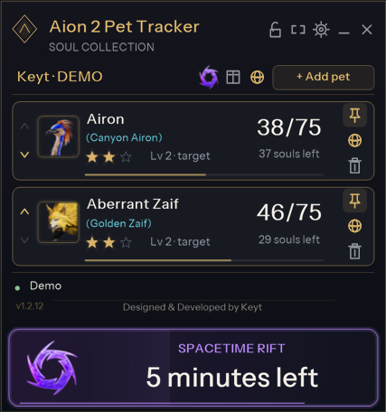
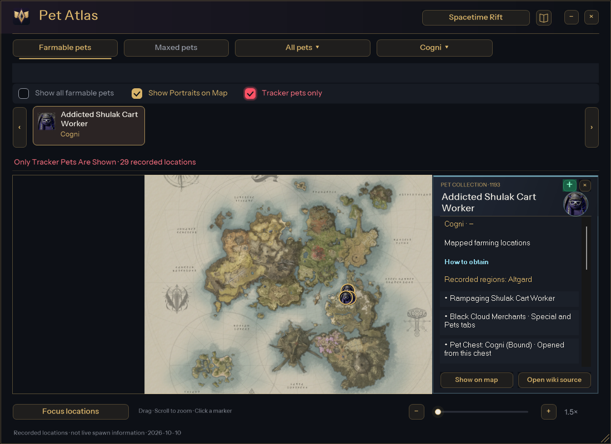
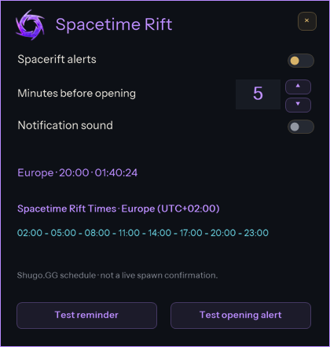
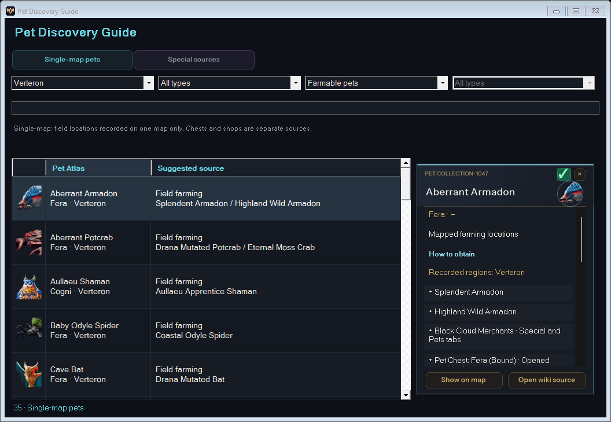

# Aion 2 Pet Tracker

A free, open-source Windows companion for **Aion 2 Global**: track pet souls, explore farming locations and keep an eye on Spacetime Rift openings.

[](https://github.com/keytftw/aion2pettracker/releases/latest)
[](LICENSE)
[](#installation)
[](https://github.com/keytftw/aion2pettracker)

**[Download for Windows](https://github.com/keytftw/aion2pettracker/releases/latest/download/A2PetTracker-win-Setup.exe)** · **[Official website](https://keytdev.com/pettracker)** · [Full guide](https://keytdev.com/pettracker/guide.html) · [Releases](https://github.com/keytftw/aion2pettracker/releases/latest)

**Completely free and ad-free. All features are available to everyone, with no premium features, subscriptions or paywalls.** [Patreon support](https://www.patreon.com/cw/keytftw) is entirely optional and does not unlock features.

<p align="center">
  
  <br><sub>The actual desktop interface with demo progress. Screenshots are application renders, not mockups or live-spawn evidence.</sub>
</p>

> **Independent community project.** Not affiliated with or endorsed by NCSOFT. Passive packet capture is not an anti-cheat exemption: detection, account restrictions or bans remain possible. Read [security and anti-cheat risks](#security-and-anti-cheat-risks) before use.

## What it does

### Pet collection tracking

- Follow pet levels, soul progress and remaining goals in a compact desktop overlay. Counts follow **soul gains, not monster kills**.
- Display pets from observed activity or add them manually. Pin, reorder and remove cards without deleting collection progress.
- See the detected monster variant beneath a pet name when that information is available; alternative names are not guessed.
- Keep preferences separate for each character/server. A fresh validated collection is required at startup.
- Recognize uncertain data: readable gains can continue under a red warning, while a fresh collection reconciles the totals.

### Interactive Pet Atlas

- Explore six bundled region maps with recorded in-game farming locations, zoom, pan, search and pet portraits or dots.
- Combine region and **pet-type filters: Cogni, Fera, Natura, Varian and Special**, plus All types.
- Browse farmable or MAX pets, including a separate category for pets without recorded coordinates.
- Open a pet's information card for its portrait, progress, available acquisition sources and wiki link. Use the highlighted **+** beside Close to add it directly to the tracker.
- Enable **Tracker pets only** to limit the displayed pets and map markers to currently visible tracker cards, together with the other active filters. A red checkbox glow and status label make the filter clear; it becomes unavailable and switches off when the tracker is empty.
- Show all matching farmable locations together, or focus a pet and choose among its recorded regions.
- Enable **Map-exclusive pets** to combine the selected region, pet type and tracker filters while excluding pets with recorded farming locations in other regions. This uses the bundled location snapshot, not a guarantee of global exclusivity.
- Open the **Pet Discovery Guide** with the book beside this filter: browse single-map pets by map, type and farmable/MAX status, or inspect special sources, known boss identities and suggested acquisition sources. Every row opens a pet card with the same tracker Add action. Source suggestions are not measured fastest routes or guaranteed drops.

Map markers are a reference guide, **not live spawns or player-position tracking**. Missing coordinates do not mean a pet cannot be farmed.

### Spacetime Rift timers and alerts

- Detect a supported Global server region from the current character identity after synchronization.
- View that region's daily schedule and UTC offset, with daylight-saving handling.
- Choose a **1–10 minute** reminder, enable or disable alerts and sound, and preview the notifications. The default reminder is five minutes before opening.
- Receive a reminder and an opening alert, each held for five seconds: below the visible tracker, or at the top left when it is hidden. Only one notification is shown at a time.

Times follow the [Shugo.GG community timetable](https://shugo.gg/timers); an opening alert is scheduled, not a live spawn confirmation. Unknown server regions suppress automatic alerts.

### Desktop experience

- A dark interface with animated transitions, clear shortcut controls and an illustrated handbook.
- Automatically grow and shrink with **1–7 visible cards**, with scrolling beyond seven; compact mode stays compact.
- Adjust opacity from **85–100%**, lock the tracker position, toggle Always on top and move Settings or Rift Settings independently.
- Use **Ctrl+P** to hide/show and **Ctrl+U** to compact/expand; both shortcuts can be changed in Settings.
- Install with a localized Windows Setup, an optional desktop shortcut and the included .NET runtime. Installed copies check stable GitHub releases for updates.
- Choose among Turkish, English, German, Russian, Spanish, French, Portuguese, Arabic, Hindi and Simplified Chinese.

## Screenshots

<table>
  <tr>
    <td width="70%" align="center"><b>Pet Atlas: filters, tracked pets and pet details</b><br><a href="docs/images/pet-atlas.png"></a></td>
    <td width="30%" align="center"><b>Spacetime Rift settings</b><br><a href="docs/images/rift-settings.png"></a></td>
  </tr>
</table>

These are screenshots rendered by the existing application's offline UI tests with demo data. Click an image to inspect it at full size.

<p align="center"><b>Pet Discovery Guide: single-map farming and acquisition sources</b><br></p>

## Installation

**Requirements:** Windows x64, Aion 2 Global and a separately installed copy of Npcap. You do not need the .NET SDK to use the release installer.

1. Install [Npcap from its official website](https://npcap.com/#download). Npcap is **not bundled or installed by this project**; its own license and installation options apply. Capture permissions, including whether elevation is required, depend on your Npcap configuration.
2. Download **[A2PetTracker-win-Setup.exe](https://github.com/keytftw/aion2pettracker/releases/latest/download/A2PetTracker-win-Setup.exe)** from the latest release. Updater `.nupkg` files are not the installer.
3. Run Setup, select a language, review the terms, choose an installation folder and optionally add a desktop shortcut.
4. Open the tracker. With it running, return to **Character Select and log in again** so the game supplies a fresh character identity and collection. The tracker opens after validation.
5. Attack a supported pet monster or use **+ Add pet**. Open the globe icon for Pet Atlas and the purple Rift icon for its settings.

Each new live session requires a fresh collection; saved counters are not treated as a current authoritative baseline. Users of older portable distributions should run Setup once to use the installed updater. Public releases provide Setup rather than a portable ZIP.

If an update check fails, Retry or Continue current version is available. Relaunching the desktop shortcut restores the running tracker instead of creating a second session.

## How passive capture works

The implementation is available for inspection in [PassiveCapture.cs](src/PetTracker.Capture/PassiveCapture.cs), [GameConnections.cs](src/PetTracker.Capture/GameConnections.cs) and the [capture project](src/PetTracker.Capture).

1. The application looks up supported Aion 2 process names, process IDs/start times and the **Windows TCP connection table** to identify a process-owned IPv4 connection on remote port `13328`. This is connection identification, not access to game-process memory.
2. **SharpPcap uses the separately installed Npcap driver** to receive traffic from the matching network adapter. The capture device is opened without requesting promiscuous mode.
3. A filter selects the exact **server-to-client TCP direction**; received packets are checked against that connection again before decoding. If more than one matching game connection exists, capture waits rather than choosing a character arbitrarily.
4. TCP reassembly and supported protocol decoding produce character identity, collection snapshots, soul events and target/NPC metadata. Soul totals use numeric Pet IDs and validated events; targeting alone adds no souls.

The application does **not** read or write game-process memory, inject DLLs, modify the game client, inject/send/replay game packets, intercept and change traffic, or automate gameplay. It does not bypass anti-cheat. Ordinary HTTPS requests to GitHub for updates are separate from the passive game capture; website and wiki links open in the default browser.

### Data quality and limitations

- Collection snapshots, soul events, session activity and UI preferences are separated. New validated snapshots reconcile real values without losing stable preferences.
- Stream/frame identity guards against replayed frames; identical Pet ID/amount values alone are not used to discard legitimate gains. Multi-pet AoE/auto-loot batches are validated before application.
- Reconnects, dropped packets, unsupported messages or protocol changes can make counts uncertain. Last-known values remain visible with a warning; subsequent readable gains can continue when identity and a collection baseline remain available. **Gains inside unreadable or missed messages may still be absent.**
- Return to Character Select and log in again when safe to obtain a fresh collection. Teleporting is not a guaranteed resynchronization method. Do not risk leaving a timed instance just to clear a warning.
- The current connection lookup supports the known IPv4/port layout. VPN, IPv6, game patches and adapter permissions can prevent capture from working. Offline tests cannot establish compatibility with every live game build.

### Local data and diagnostics

Character/server identifiers, collection state, preferences and text diagnostics are stored under `%LOCALAPPDATA%\Aion2PetTracker`. Fresh sessions discard cached live totals while retaining stable preferences.

The tracker does not ask for your game password or automatically upload collection state or diagnostic reports to a developer service. It does not write full PCAP captures. **Text logs can include character/server identifiers and bounded hexadecimal snippets of unsupported soul messages**, so review and redact diagnostics before posting them publicly. Automatic bug-email submission is not implemented; sharing a report is manual.

## Security and anti-cheat risks

**There is no official NCSOFT approval and no guarantee of anti-cheat safety, invisibility or freedom from account sanctions.** Passive capture does not establish permission to use a third-party tool. Publisher rules and enforcement can change, and use may result in temporary restrictions or permanent bans.

Precautions in the implementation include connection scoping, server-direction filtering, no game-memory access or packet injection, explicit consent before live use, validation of decoded data and uncertainty warnings. These describe implementation choices, **not an anti-cheat certification or an independent security audit**.

Review the game's current rules and the [in-app terms source](src/PetTracker.App/TermsContent.cs) before use. Do not disable anti-cheat, antivirus or other security protections to run the tracker. If you are unsure whether a tool is permitted, seek clarification from the publisher rather than treating this README as authorization.

Use the [official repository](https://github.com/keytftw/aion2pettracker) and [GitHub releases](https://github.com/keytftw/aion2pettracker/releases) as distribution sources. Release asset details provide SHA-256 digests, and releases include corresponding source archives. A hash or antivirus result alone does not prove a binary is safe; code signing remains a separate distribution task.

## Help and contributions

- **Learn:** [website and full guide](https://keytdev.com/pettracker) · [patch notes](https://keytdev.com/pettracker/patch-notes.html).
- **Report a problem:** [open a GitHub issue](https://github.com/keytftw/aion2pettracker/issues) with the app version, Windows version, server region, steps to reproduce and expected/actual behavior. Use Settings → Diagnostics if needed, and redact identifying information first.
- **Contact:** [support@keytdev.com](mailto:support@keytdev.com). Use email for information you do not want in a public issue; do not send passwords or account credentials.
- **Contribute:** [pull requests](https://github.com/keytftw/aion2pettracker/pulls) for focused fixes, documentation, translations, tests and verified data corrections are welcome. Discuss larger changes in an issue first, preserve attribution and include relevant tests.

### Build from source

Development requires **Windows x64 and the .NET 10 SDK**; the SDK version/roll-forward policy is in [global.json](global.json). From a checkout of this repository:

```powershell
git clone https://github.com/keytftw/aion2pettracker.git
cd aion2pettracker
dotnet build PetTracker.slnx -c Release -m:1
dotnet test PetTracker.slnx -c Release --no-build --no-restore -m:1
```

The [test projects](tests) exercise state reconciliation, identity isolation, batch soul gains, pin/delete retention, installer logic, localization, map data/filtering, camera behavior and elapsed-time animation. Source-based UI tests render demo forms without starting live capture; they do not launch packaged installers or tracker binaries. Passing offline tests is not evidence of anti-cheat approval or guaranteed live accuracy.

<details>
<summary><b>Developer reference: controls, data and rendering</b></summary>

- Level stages have within-stage goals of **5 / 25 / 75**; 105 total souls reaches Lv 3 MAX. Shard/crystal messages do not provide reliable pet attribution and are not counted as pet souls.
- A non-MAX attack can display a card without incrementing its counter; MAX pets can be added manually. Unpinning removes only the pin, retaining the card. Delete/CLEAR removes the visible card and its pin, preserving progress. A subsequent real soul gain can reactivate it.
- Pins, retained cards and saved order are scoped to character/server. Up/down arrows reorder cards. The full tracker fits one to seven card slots, grows and shrinks after additions/removals and scrolls beyond seven. Empty retains one slot. Position lock is separate from sizing.
- Custom shortcuts accept Ctrl/Alt/Shift with a letter, digit or F1–F24. Conflicting combinations are rejected and held keys do not repeatedly toggle. MAX transitions can play a subtle sound; hover CLEAR removes a MAX card.
- The catalog contains **207 IDs, including seven Special entries**; this is not a claim that the game displays 207 regular collection pets. The bundled map snapshot associates 200 IDs with six maps and has coordinates for 160 pets. Acquisition records are wiki-matched for 206 catalog entries, with the remaining entry explicitly unconfirmed.
- Multi-region cards provide a Show on map menu. Region filters exclude pets without coordinates in that region; All pets and Pets without locations retain access to acquisition information. Portrait markers and dots use saved preferences; nearby markers of the same pet are coalesced at the current zoom.
- Maps/terrain are bundled; no WebView2 or online map dependency is required. The current map bitmap is disposed when regions change. Region, map size and position persist.
- The separate illustrated handbook has eight pages and can be opened from the tracker, Pet Atlas or Setup's button below its progress bar. Setup's completed-work progress screen remains visible for at least six seconds and never reports completion before installation steps finish.
- Rift alerts start enabled for new settings; a saved opt-out remains respected. Delivered reminder keys are retained to reduce repeats across restarts. Unsupported server identities suppress automatic alerts.
- Rendering caches text and portraits, uses elapsed-time easing and lowers timer activity when idle or hidden. Active animation uses an 8 ms timer request, which is not a guarantee of an 8 ms frame interval. Offline seven-card paint measurements have varied by revision and environment: a prior local 96-DPI comparison measured 10.31 → 4.19 ms median and 354,984 → 36,216 allocated bytes/frame. These are historical offline measurements, not in-game FPS guarantees.
- Manual validation still includes fluidity under game load, installation/update/restart behavior and live collection recovery after data gaps. Development instructions prohibit executing packaged installers or application binaries during local development.

</details>

<details>
<summary><b>Maintainer reference: release packaging</b></summary>

Install the pinned packaging tool and build the installer:

```powershell
dotnet tool install vpk --version 1.2.161 --tool-path .tools/vpk
./tools/Build-Setup.ps1
```

[Build-Setup.ps1](tools/Build-Setup.ps1) publishes the app, checks required data/portraits/maps/licenses, disables portable generation and skips Velopack's app-execution probe. The localized wizard embeds the matching installer payload with a SHA-256 integrity check. Installation runs only after the user's consent and Install action; successful installation writes the installation profile and preferences.

For publication, use **Actions → Build and publish updater release → Run workflow**. App and Setup project versions must match and be incremented before a release. The [workflow](.github/workflows/release.yml) builds/tests on Windows, packages the installed Velopack feed and publishes the public Setup, full/delta update packages, feed metadata and corresponding source ZIP. User update checks need no GitHub token. A fresh collection is required after updating.

</details>

## License and acknowledgements

Distributed under [GNU GPL-3.0](LICENSE). Required capture/protocol/catalog components have attribution; the tracker state and desktop interface are independently implemented. Third-party code, fonts, maps, portraits and server-data sources are documented in [THIRD_PARTY_NOTICES.md](THIRD_PARTY_NOTICES.md), [data/PET-SOURCES.md](data/PET-SOURCES.md) and [licenses/](licenses).

Aion 2 names, game artwork and trademarks belong to NCSOFT and their respective owners. Their inclusion does not imply affiliation or endorsement.

## Optional support

If the tracker is useful to you, you can [support Keyt on Patreon](https://www.patreon.com/cw/keytftw). Donations are optional: the application stays **free, ad-free and fully featured**, whether you donate or not.
